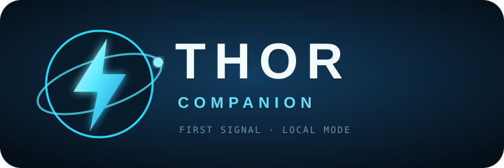
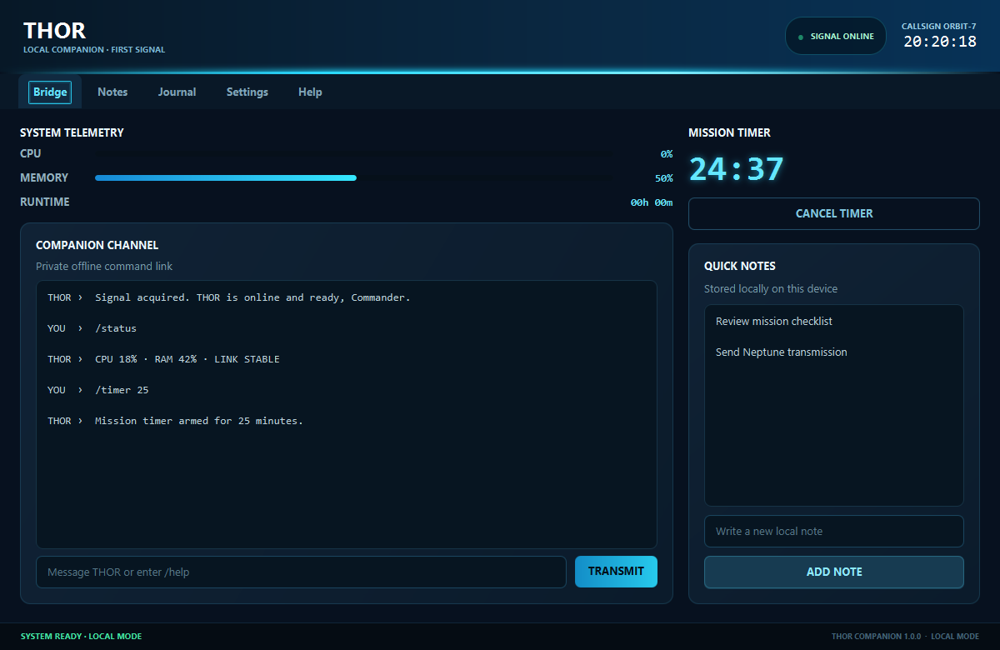

<p align="center">
  
</p>

# THOR Companion

[](https://github.com/sofoste93/THOR-Companion/actions/workflows/ci.yml)
[](https://adoptium.net/)
[](https://github.com/sofoste93/THOR-Companion/releases/latest)
[](LICENSE)

THOR is a small local-first desktop companion presented as a calm spacecraft
console. It combines useful offline tools with live system telemetry and keeps
its data on your device.



## Download

Open the [latest release](https://github.com/sofoste93/THOR-Companion/releases/latest)
and choose the package for Windows, Linux, macOS Intel or macOS Apple Silicon.
Every package includes its own Java runtime, so Java does not need to be
installed separately.

Extract the archive and launch **THOR Companion**. Windows and macOS may show a
publisher warning until the downloadable builds are signed with a trusted code
signing certificate.

## First signal features

- private offline command channel with `/help`, `/status`, `/note` and `/timer`;
- quick notes and a timestamped mission journal;
- animated CPU, memory and application-runtime telemetry;
- focus timer from 1 to 180 minutes;
- English, French and German interfaces;
- configurable callsign and reduced-motion setting;
- local data folder visible from the Help panel;
- no account, network service or telemetry upload.

THOR stores readable text files in `.thor-companion` below your home directory.
The files are local but not encrypted, so they should not contain passwords or
other secrets.

## Run from source

Requirements: JDK 17 and Maven 3.9 or newer.

```bash
mvn clean verify
mvn javafx:run
```

Create the standalone Windows package:

```powershell
powershell -ExecutionPolicy Bypass -File .\scripts\package.ps1
```

Regenerate the interface screenshot from the real application:

```powershell
java -jar target\thor-companion-1.0.0-all.jar --screenshot docs\thor-companion.png
```

## Learn with the project

The [guided tutorial](docs/TUTORIAL.md) follows a command from the text field to
the local store. Clear comments explain the boundaries that matter without
repeating every Java statement.

- `CommandEngine` parses commands without knowing anything about JavaFX.
- `ThorController` coordinates the interface and application services.
- `CompanionStore` owns local persistence and atomic settings updates.
- `TelemetryService` reads CPU, memory and runtime measurements.
- `thor-view.fxml` defines structure while `thor.css` defines the visual theme.

Eight automated tests cover commands, timer limits, persistence, ordering,
journal events and complete translations.

## Roadmap

The desktop release establishes THOR's offline core. A future mobile companion
can reuse the command vocabulary and local-first rules without exposing desktop
files or silently adding a cloud dependency.

Licensed under the [MIT License](LICENSE).
